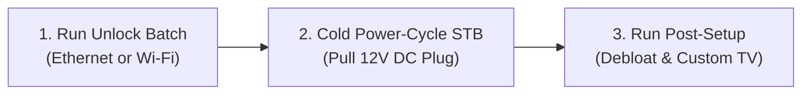

# Jio STB Master Toolkit (ADB Unlock, FOTA Capture & Firmware Catalog)

<p align="center">
  <a href="https://github.com/krishnasen2401/jiostb/stargazers"></a>
  <a href="https://github.com/krishnasen2401/jiostb/network/members"></a>
  <a href="https://github.com/krishnasen2401/jiostb/issues"></a>
  <a href="LICENSE"></a>
</p>

> ⭐ **If this project helped unlock, debloat, or revive your Jio STB, please support us by starring this repository on GitHub!**  
> Starring helps more users discover this open-source tool, prevents paywalled scam services, and fuels continuous firmware research and development.

A complete, production-grade toolkit to **unlock permanent ADB**, **debloat & customize**, **intercept & capture official firmware updates**, and **query Reliance Jio's live TR-069 ACS**.

Supports all hardware generations of Reliance Jio Set-Top Boxes (**JHS D200 v1/v2/v5**, **JHS C200**, **JMSB200A**, **JMSD200A**) via both **Direct P2P Ethernet** and **Wi-Fi Mobile Hotspot**.

---

## ⚡ Quick Start: 3-Step Unlock & Debloat



1. **Run the Unlocker:** Double-click **`UNLOCK_ADB_ETHERNET.bat`** (or **`UNLOCK_ADB_ORIGINAL_LAB.bat`** for the original verified zero-401 standalone lab).
2. **Reboot the Box:** Unplug the **12V DC power cord** from the back of the STB, wait 5 seconds, and plug it back in.
3. **Customize & Debloat:** Once the console prints the success banner, double-click **`1CLICK_POST_ADB_SETUP.bat`** to install Projectivy Launcher, Aptoide TV, TV Bro, CleanYourTV remote hotkeys, and debloat stock Jio ads.

---

## ⚠️ Pre-Flight Checklist (Read Before You Begin)

To ensure a smooth, error-free unlock on your first try, follow these 3 critical rules:

> [!IMPORTANT]
> 1. **Temporarily Disable Windows Firewall & Antivirus:**  
>    Windows Defender Firewall or third-party suites (**Quick Heal**, **McAfee**, **Norton**) will silently drop inbound packets on ports `53` (DNS) and `8443`/`9443` (TR-069). **Turn them OFF for 15 minutes** while unlocking.
> 2. **Always Cold Power-Cycle (12V DC Plug):**  
>    **Do NOT use the remote power button!** Jio STB remote power only puts the device into a low-power standby state (`suspend-to-RAM`) where TR-069 does **not** re-initialize. You **must pull the physical 12V DC adapter barrel plug** from the back of the box, wait 5 seconds, and plug it back in.
> 3. **Select Universal Auto-Select (Option 1):**  
>    When the script prompts for model family:
>    * Press `1` for **Universal Auto-Select [DEFAULT]** (covers all hardware: `JHSD200`, `JHSC200`, `JMSC200A`, `JMSD200A`, `JMSB200A`, AirFiber) $\to$ loads verified `forged_chain.pem` (eMudhra + Comodo AAA CA, pre-trusted by all Android builds).
>    * Press `2` for **Legacy / Custom fallback** $\to$ loads `acs_chain.pem`.
> 4. **Stuck in a Loop or TLS Error? Perform a Quick Factory Reset:**  
>    If your STB repeatedly rejects TLS (`SSLV3_ALERT_CERTIFICATE_UNKNOWN`) or gets stuck in a captive portal polling loop (`/generate_204` or `/cloud_dvr/...`), the internal `com.jio.tr069client` daemon has entered an **exponential backoff state** in `/data` from an earlier interrupted session.  
>    **Fix:** Perform a **Factory Reset** on the STB (**Settings** $\to$ **Device Preferences** $\to$ **Reset** $\to$ **Erase Everything**, or hold the bottom pinhole recovery button while powering on). During the fresh Initial Setup Wizard, connect to the lab. In this clean state, the STB immediately prioritizes TR-069 provisioning and unlocks on the very first boot!

---

## 📚 Project Wiki & Documentation Directory

Detailed research, full firmware tables, and advanced modification guides are split into dedicated documents:

| Document / Guide | Description |
| :--- | :--- |
| 🛠️ **[`DEBLOAT_GUIDE.md`](DEBLOAT_GUIDE.md)** | **Post-ADB Debloating & Customization Guide:** Permanent removal of iWedia launcher (bypassing Jio's `Relax SCAN_REQUIRE_KNOWN` reboot reset via `pm uninstall --user 0`), Monet/Projectivy setup, forced Dark Mode, remote hotkey remapping (`TVHome.apk`), **bundled OTT subscription preservation rules**, and **JioTV+ v6 upgrade guide with any-ISP mobile OTP login**. |
| 📦 **[`FIRMWARE_CATALOG.md`](FIRMWARE_CATALOG.md)** | **45+ Verified Official Firmware Packages & Direct Download Links:** Complete archive of Akamai URLs covering Franklin (`JHSD200`, `JHSC200v2`, `JHSC200v3`), Legacy SDMC (`DV8545-Cn2`), 4K OTT STBs (`MSTB` A/B updates), Hotel builds (`*-H`), Jio Smart Displays (`curie`), and Media Hubs (`MCM3000`). |
| 🤖 **[`AGENTS.md`](AGENTS.md)** | **Autonomous AI Agent Runbook:** Machine-actionable protocols for AI agents (Claude Code, GPT, Antigravity) to autonomously detect hardware revisions, run 1-click ADB unlocks, and execute debloating. |
| 🛡️ **[Anti-Brick Safety Matrix](#-anti-brick-architecture--safety-guidelines)** | Full architectural breakdown explaining why standard non-destructive TR-069 RPCs prevent bricking your box. |
| 🌐 **[Community & Credits](#-credits--acknowledgements)** | Acknowledgments, source references, and upstream research from OnlyTech Forums, GitHub, and XDA. |

---

## 📥 Downloading & Running the Toolkit

### Recommended: Clone via Git (Bypasses SmartScreen False-Positives)
If you download the repository as a `.zip` from GitHub, Windows Defender or SmartScreen may flag it as a generic false-positive (e.g., `Trojan:Script/Wacatac.B!ml`). This happens because the ZIP contains automated administrative batch scripts (`.bat` / `.ps1`) that reconfigure network adapters, bind local ports (53, 8443), and bundle Android tools (`adb.exe`).

To avoid download blocks completely, clone directly using Git:
```bash
git clone https://github.com/krishnasen2401/jiostb.git
cd jiostb
```

> [!TIP]
> **If Downloading the ZIP Archive Directly in Edge / Chrome:**
> * **Edge:** In the download tray, click `...` next to the blocked file $\to$ **Keep** $\to$ **Show more** $\to$ **Keep anyway**.
> * **Chrome:** Press `Ctrl + J` $\to$ Click **Keep dangerous file** $\to$ **Keep anyway**.
> * **Windows Security:** Go to *Windows Security $\to$ Virus & threat protection $\to$ Protection history $\to$ Click detection $\to$ Actions $\to$ Allow on device*.

---

## 🚀 1-Click ADB Unlock Launchers

> [!TIP]
> **Zero Manual Setup Required:** All 1-click `.bat` launchers include automated self-healing dependency checks. If `pycryptodome`, `requests`, or `urllib3` are missing, the launcher automatically installs them via pip on first run! (Manual install: `pip install -r requirements.txt`).

### Method A: Direct Ethernet Mode (Recommended — Fast & 100% Reliable)

Direct Ethernet mode creates an isolated, deterministic network between your PC and the STB, completely bypassing home router firewall rules and Wi-Fi interference.

1. **Network Cabling:**
   * Keep your **PC connected to Wi-Fi / Internet** (if using Online Relay Mode to relay live Undertow challenge nonces from Reliance Jio's live ACS; see [FAQ #3](#3-do-i-need-an-active-jiofiber-connection-for-online-mode-vs-offline-mode) for 100% offline usage).
   * Connect an RJ45 Ethernet cable **directly between your PC's Ethernet port and the Jio STB** (do NOT plug the cable into your home router).
2. Double-click **`UNLOCK_ADB_ETHERNET.bat`** (Accept the Windows UAC Administrator prompt).
3. **Select your STB Model Family:**
   * Enter `1` for **Universal Auto-Select [DEFAULT]** (`JHSD200`, `JHSC200`, `JMSC200A`, `JMSD200A`, `JMSB200A`, AirFiber) $\to$ loads `forged_chain.pem` (eMudhra chain).
   * Enter `2` for **Legacy / Custom fallback** $\to$ loads `acs_chain.pem`.
4. **Cold Power-Cycle the STB:**
   * Unplug the 12V DC power cable from the back of the STB.
   * Wait 5 seconds $\to$ Reconnect power.
5. **Patience Window (Leave Console Running for 1–2 Minutes):**
   * Early connections on port `[:443]` with `closed by peer` are standard Android OS background telemetry.
   * The actual TR-069 service (`com.jio.tr069client`) initializes on port **`[:8443]`** (or `[:9443]`) roughly **45 to 60 seconds after power-on**.
   * The lab terminates TLS, synchronizes the STB clock to 2026 via NTP, relays authentication nonces, and injects `Device.JioSTB.USB.USBDebugging = true` (valid until 2037).
6. **Success Banner & Connection:**
   * As soon as the command is accepted, an ASCII banner will appear:
     ```text
     ======================================================================
       🎉 SUCCESS: JIO STB ADB IS FULLY UNLOCKED!
       Device: Droidlogic JHSD200 (STB IP: 192.168.50.2:5555)

       ACTION REQUIRED ON YOUR TV SCREEN RIGHT NOW:
       1. Turn on your TV screen.
       2. A popup dialog will appear: "Allow USB debugging?".
       3. Check "Always allow from this computer" with your remote.
       4. Select "Allow" / "OK".
     ======================================================================
     ```
   * Open a second terminal or run `.\1CLICK_POST_ADB_SETUP.bat` to complete setup!

> [!NOTE]
> **Automated Port 443 Blocking & Zero TLS Noise:**
> Background Android apps on the STB (Google Play Services, analytics, ad engines) probe the network on port 443 with public CAs (`SSLV3_ALERT_CERTIFICATE_UNKNOWN`). The toolkit automatically creates a kernel-level inbound firewall block rule (`LocalLab-Block-Port443`), dropping this noise before it reaches user space.

---

### Method B: Wi-Fi Hotspot Mode (For Laptops without Ethernet)

If your laptop does not have an Ethernet port and you do not have a USB-to-Ethernet adapter:

1. Open Windows Settings $\to$ **Network & internet** $\to$ **Mobile hotspot**.
2. Configure SSID: `JioSTB-Setup`, Password: `password123`, Band: **2.4 GHz**.
3. Toggle Mobile Hotspot to **ON**.
   > [!TIP]
   > Windows 11 strictly requires an active internet connection to enable Mobile Hotspot. Connect your PC to your mobile phone's hotspot or home Wi-Fi first, turn Windows Mobile Hotspot **ON**, and then proceed. (See [FAQ #4](#4-windows-11-mobile-hotspot-fails-says-no-internet-to-share-or-wi-fi-loops-onoff-hp-victus--amd--mediatek-mt7921) if using HP Victus / AMD / MediaTek Wi-Fi).
4. Double-click **`UNLOCK_ADB_WIFI.bat`** (Accept Admin prompt).
5. Select your model family (`1` or `2`).
6. Connect the STB to the `JioSTB-Setup` Wi-Fi network and cold-reboot it (unplug 12V DC power $\to$ wait 5s $\to$ replug).
7. Connect via ADB to the assigned IP logged in the console:
   ```cmd
   adb connect 192.168.137.x:5555
   ```

---

## 📺 Post-ADB Setup: Debloating & Android TV Ecosystem

Once ADB is unlocked, customize your Jio STB into a clean, ad-free Google TV / Android TV experience!

Double-click **`1CLICK_POST_ADB_SETUP.bat`** (or run `python post_adb_setup.py`). The script automatically connects, detects your STB model, debloats unwanted packages, and installs the TV companion ecosystem.

### Bundled Companion TV Apps (in `apks/`):

| Companion App | Purpose & Features |
| :--- | :--- |
| 🚀 **`ProjectivyLauncher.apk`** | Premium Leanback Google TV / Apple TV-style launcher. Features channel rows, "Watch Next" queue, customizable categories, and 100% remote control navigation. |
| 🎨 **`monet-launcher.apk`** | Ultra-lightweight Material You Android TV launcher for maximum performance. |
| 🛍️ **`AptoideTV.apk`** | **Official Leanback Android TV App Store:** Serves remote-friendly, 10-ft TV APKs exclusively. Replaces phone/tablet app stores that crash or fail D-Pad navigation. |
| 🌐 **`TVBro.apk`** | **Open-Source TV Web Browser & APK Downloader:** Full remote-control navigation, built-in ad blocker, and direct APK download manager. |
| 🔀 **`stn_bridge_atv.apk`** | **SmartTube Intent Bridge:** Intercepts official YouTube Leanback intents and routes them directly to SmartTube for ad-free playback. |
| 🎮 **`TVHome.apk` (CleanYourTV)** | Dedicated remote hotkey mapper: remap Netflix, Hotstar, Prime, and physical Mic/Voice buttons to launch custom apps. |
| ⚙️ **`AndroidSettingsShortcut.apk`** | Direct launcher for native Android TV Settings (`com.android.tv.settings`) — used for Bluetooth audio pairing, Wi-Fi configuration, and Developer Options. |
| 📺 **`mediashell.apk`** | Production Google Cast receiver update enabling genuine Chromecast built-in streaming. |
| 📱 **`OpenShelf-0.7.0.apk`** | FOSS Android TV App Store connecting directly to GitHub releases. |
| 🐚 **`shevery-release.apk`** | On-device Shizuku shell (`uid=2000`) for PC-free package management. |

### Restoring Google Cast (Chromecast Built-in)
Stock Jio firmware ships `com.google.android.apps.mediashell` as an empty **0 MB placeholder stub** (`v0.0`, `versionCode=1`) in `/product/priv-app`. As a result, casting from smartphones or Chrome fails with `ClassNotFoundException`.

The setup script automatically sideloads the official production update:
```bash
adb install -r apks/mediashell.apk
```
The STB immediately registers with Google Cast client ID and broadcasts across your local Wi-Fi network as a genuine Chromecast built-in receiver (e.g. "Living Room TV").

> [!TIP]
> For complete instructions on permanently replacing the iWedia launcher, configuring custom button mappings, and logging into JioTV+ on any non-Jio ISP using mobile OTP, see the **[`DEBLOAT_GUIDE.md`](DEBLOAT_GUIDE.md)**!

---

## ❓ Frequently Asked Questions & Troubleshooting

### 1. The Mock ACS console is silent or the handshake is not recognized?
* **Windows Defender / Antivirus Firewall:**  
  Windows Defender Firewall (or third-party suites like **Quick Heal**, **McAfee**, **Norton**, **Bitdefender**) is dropping inbound traffic on ports **`53`** (DNS), **`123`** (NTP), **`8443`**, and **`9443`** (TR-069).
  * **Fix:** Temporarily **turn OFF Windows Defender Firewall** (and pause third-party antivirus shields for 15 minutes) while running the unlock script. Once ADB is unlocked, re-enable it.
* **Cold Reboot Required:**  
  Did you pull the physical 12V DC power plug? Soft-rebooting via remote control does not re-trigger TR-069.
* **Model Selection:**  
  Press **Enter** for **Option `1` [Universal Auto-Select] [DEFAULT]**. This serves the verified universal eMudhra certificate (`forged_chain.pem`), which is trusted natively across all boxes (`JMSD200A`, `JMSC200A`, `JMSB200A`, `JHSD200`, `JHSC200`). Option 2 is only an experimental fallback.
* **Persistent TLS Rejection or Captive Portal Loop? (Factory Reset Fix):**  
  If your STB continuously rejects the handshake or gets stuck repeatedly querying `/generate_204` and `/cloud_dvr/services_...`, `com.jio.tr069client` has entered an internal **exponential backoff state** in `/data`.  
  **Fix:** Perform a **Factory Reset** on the STB (TV Settings $\to$ Device Preferences $\to$ Reset $\to$ Erase Everything, or hold the bottom pinhole recovery button while powering on). Once reset and on the initial Welcome/Setup screen, connect the Ethernet cable to the PC running `UNLOCK_ADB_ETHERNET.bat`. In this virgin state, the STB immediately prioritizes TR-069 provisioning and unlocks cleanly!

---

### 2. What STB IP address should I connect to with ADB?
Look at the incoming connection lines in your Mock ACS terminal:
```text
[15:35:35] 192.168.5.69:32786 [:9443] ...
```
* In Direct P2P Ethernet mode, the default STB IP is `192.168.50.2`.
* In Wi-Fi Hotspot mode, the STB is assigned `192.168.137.x`.
* If connected via your home router or switch, the STB gets an IP from your router (e.g. `192.168.5.69` or `192.168.29.x`).
* **Always use the STB IP displayed in the console success banner:**
  ```cmd
  adb connect <YOUR_STB_IP>:5555
  ```

---

### 3. Do I need an active JioFiber connection for Online Mode vs. Offline Mode?

* **Online Relay Mode (Variant 1):**
  * **Requires an active JioFiber connection.**
  * The upstream Jio ACS server (`acs.oss.jio.com` $\to$ `49.40.134.113:8443`) is an **internal private Jio IP** reachable only through JioFiber. Non-Jio ISPs cannot route to `49.40.134.113`.
* **Offline Standalone Mode (Variant 2 - Default Auto-Fallback):**
  * **Requires ZERO Jio connection and ZERO internet access!**
  * If your PC is offline, connected to a non-Jio ISP (Airtel, ACT, mobile hotspot), or plugged directly into the STB via an isolated Ethernet cable, the toolkit automatically falls back to **100% Offline Standalone Mock ACS**.
  * It generates authentic Undertow MD5 nonces locally, mimics Jio's CWMP server, and injects `Device.JioSTB.USB.USBDebugging = true` completely offline.
  * You can unlock your STB anywhere on any computer without needing an active JioFiber subscription!

---

### 4. Windows 11 Mobile Hotspot fails, says "No Internet to share", or Wi-Fi loops ON/OFF (HP Victus / AMD / MediaTek MT7921)?

#### Why this happens:
1. **Windows 11 Internet Sharing Dependency:** Windows 11 Mobile Hotspot relies on Internet Connection Sharing (ICS). If the PC is completely offline, Windows 11 blocks hotspot creation with *"We can't set up mobile hotspot because your PC doesn't have an Ethernet, Wi-Fi, or cellular data connection."*
2. **Wi-Fi On/Off Looping on HP Victus AMD:** HP Victus 16 AMD laptops commonly ship with **MediaTek MT7921 / MT7922 (AMD RZ608/RZ616)** or **Realtek RTL8852AE/BE** Wi-Fi cards. Modern Windows 11 WDI/NDIS 6.5+ drivers deprecate legacy Hosted Network. When legacy SoftAP commands are issued or driver crashes occur, Windows Plug-and-Play resets the Wi-Fi card in an infinite loop.

#### Solutions & Workarounds:
* **Option A: Use Direct P2P Ethernet (`UNLOCK_ADB_ETHERNET.bat`) — Most Reliable:**  
  Ethernet requires **zero Wi-Fi drivers, zero internet access, and zero ICS**. It creates an isolated static subnet (`192.168.50.1`), completely bypassing Windows Hotspot bugs.
* **Option B: Connect PC to Phone Hotspot First:**  
  Connect your PC to your phone's hotspot or home Wi-Fi first so Windows 11 sees an active internet connection, toggle Windows Mobile Hotspot to **ON**, and then run `UNLOCK_ADB_WIFI.bat`.
* **Option C: Fix Wi-Fi Looping in Device Manager:**  
  Open **Device Manager** $\to$ **Network adapters** $\to$ Right-click **MediaTek Wi-Fi 6 (MT7921/RZ608)** $\to$ **Properties** $\to$ **Power Management** $\to$ **Uncheck** *"Allow the computer to turn off this device to save power"*.

---

### 5. I see `closed by peer` or `SSLV3_ALERT_CERTIFICATE_UNKNOWN` on port 443 — did it fail?
**No, it did NOT fail.**
* Early boot connections on port 443 are background Android apps (Google Play Services, analytics, ad engines) trying to reach external HTTPS servers.
* The actual TR-069 management service (`com.jio.tr069client`) connects on port **`8443`** (JMS Series) or **`9443`** (JHS Series) roughly **45 to 60 seconds after power-on**.
* The toolkit's automated Windows firewall block silently drops port 443 noise. Leave the console open for 1–2 minutes after power-cycling until the success banner appears!

---

### 6. Why does `QUERY_JIO_ACS.bat` fail with `ConnectTimeoutError` (49.40.134.113)?
* **`QUERY_JIO_ACS.bat` is NOT required for local STB unlocking!**
* `QUERY_JIO_ACS.bat` is an advanced cloud-research tool that queries Reliance Jio's remote servers across an active JioFiber WAN. All local unlocks use `UNLOCK_ADB_ETHERNET.bat` or `UNLOCK_ADB_WIFI.bat`.

---

### 7. How to Read the Diagnostic Logs & Open a GitHub Issue
If your STB does not unlock after 2 minutes, check the 3 diagnostic log files generated automatically in the toolkit root folder:

| Log File | What It Records |
| :--- | :--- |
| **`mock_acs.log`** | TCP connections, TLS handshakes, target ports (`:443`, `:8443`, `:9443`), and TR-069 session lifecycle. |
| **`captive_lab.log`** | DHCP IP leases (`192.168.50.2`), NTP time sync (setting STB clock to 2026), DNS spoofing resolutions, and HTTP 204 captive portal requests. |
| **`mock_acs_packets.log`** | Full decrypted XML packet dump of all TR-069 `cwmp:Inform`, Digest Authentication handshakes, and `SetParameterValues` RPC responses. |

To open an issue:
1. Go to [Issues $\to$ New Issue](https://github.com/krishnasen2401/jiostb/issues/new).
2. Specify your **Model** (e.g. `JHSD200 v2/v5` or `JMSD200A`) and firmware version.
3. Attach `mock_acs.log`, `captive_lab.log`, and `mock_acs_packets.log` directly into the issue.

---

### Stopping Labs & Cleaning Ports
Whenever you finish testing, double-click **`STOP_ALL_LABS.bat`** to terminate all background listeners, free ports (`53, 67, 80, 123, 443, 7443, 8443, 9443`), and restart Windows Time Service (`w32time`).

---

## 🔬 Advanced Research & Firmware Capture Labs

### Module 2: Firmware Capture & TR-069 MITM Lab

Intercept OTA firmware packages as they are offered by Jio's production ACS:

#### A. Ethernet MITM Mode
1. Double-click **`CAPTURE_FIRMWARE_ETHERNET.bat`** (or `RUN_ETHERNET_LAB.bat`).
2. On the STB, navigate to **Settings** $\to$ **System Settings** $\to$ **Software Update**.
3. The lab intercepts the update check, dynamically spoofs the software version specified in `spoofed_version.txt`, and relays to Jio's live ACS.
4. When ACS offers an update, the download URL is captured and saved to `fota_firmware_url.txt` and `fota_update_found.json`.

#### B. Wi-Fi Hotspot MITM Mode
1. Turn on Windows Mobile Hotspot.
2. Double-click **`CAPTURE_FIRMWARE_WIFI.bat`** (or `RUN_WIFI_HOTSPOT_LAB.bat`).
3. Connect the STB and trigger a software update check.

---

### Module 3: Standalone PC Query Tool (No STB Hardware Needed!)
1. Double-click **`QUERY_JIO_ACS.bat`**.
2. Enter the target software version to test (e.g. `STB-JHSD200-11.1.0` or press Enter for default).
3. The script computes the CPE HTTP Digest authentication formula (`ro.acsdata` + native secret key), opens a CWMP session directly with Jio's real ACS (`https://49.40.134.113:8443/ftacs-digest/ACS`), and prints all server directives.

#### Extracting Credentials from Your Own Box (First-Time Setup)
To use `QUERY_JIO_ACS.bat` with your own box's credentials rather than our built-in profile:
1. Connect your STB via ADB (`adb connect <IP>:5555`).
2. Double-click **`EXTRACT_CREDENTIALS.bat`** (runs `dump_credentials.py`).
3. It extracts your serial number, reads `ro.acsdata`, computes your CPE password, and saves `device_credentials.json`.
4. `query_acs_direct.py` will now automatically use your device profile for all future queries!

---

### Module 4: Model-Specific Version Spoofing (`spoofed_version.txt`)
When capturing firmware on an active box or running queries, the spoofed version must match the hardware line:
* **JHS D200 v2 / v5 (Android 11 / DIN995):** `STB-JHSD200-11.1.0` (Triggers ACS to offer `11.3.46` / `qdOdPlaXso.zip`)
* **JHS D200 v1 (Android 9 / Droidlogic):** `STB-JHSD200-5.6.8` (Triggers ACS to offer `5.7.1`)
* **JHS C200 (Android 9 / SDMC):** `STB-JHSC200-5.6.8` (Triggers ACS to offer `5.7.1`)
* **JMSB200A / JMSD200A (JioAirFiber):** `24.1.39` or `22.1.09` (Triggers ACS to offer `25.1.9`)

Simply edit [`spoofed_version.txt`](spoofed_version.txt) with your target version before running the capture lab.

---

### Module 5: Submitting Discovered Firmware to the Catalog
When a new firmware update is intercepted, the lab saves the URL to `fota_update_found.json`.
* **Option A (Google Form - 30 seconds, no GitHub required):**  
  Fill out the [Jio Firmware Submission Google Form](https://forms.gle/thYgeHvudJRGabWn7) with the Akamai URL and model.
* **Option B (1-Click Batch Helper):**  
  1. Double-click **`SHARE_NEW_FIRMWARE.bat`** (runs `share_firmware.py`).
  2. It previews the discovered URL and file size.
  3. With your explicit consent, it opens GitHub to submit the new link as an issue.
* **Privacy Guarantee:** Only the public download URL, file size, and target model are submitted. Device serial numbers, MAC addresses, and credentials are **never** included or transmitted.

---

## 🌟 Discovered Official Firmware Packages (Direct Downloads)

All firmware images listed below are directly hosted on Reliance Jio's public Akamai NetStorage servers without authentication.

### 1. Jio Set-Top Boxes (STBs)
| Model / Codename | Version | Android Version | Package Size | Direct Download Link | Notes |
| :--- | :--- | :--- | :--- | :--- | :--- |
| **JHS D200 v2 / v5** (`franklin_bluebank`) | `11.3.46` | **Android 11** | **792.3 MB** | [Download qdOdPlaXso.zip](http://fota.slv.kai.jiophone.net/BHTS/DIN995/B002D_346/qdOdPlaXso.zip) | **Full block OTA** containing `boot.img`, `recovery.img`, `bootloader.img`, `super_empty_all.img`, `system.new.dat.br`, `vendor.new.dat.br` |
| **JHS D200 v1** (`franklin`) | `5.7.1` | **Android 9 (Pie)** | **533.3 MB** | [Download STB-JHSD200-5.7.1.zip](http://fota.slv.fxd.jiophone.net/STB/Droidlogic/JHSD200/STB-JHSD200-5.7.1.zip) | Full block Android 9 OTA package for D200 v1 |
| **JHS C200** (`DV8545-Cn2`) | `5.7.1` | **Android 9 (Pie)** | **532.0 MB** | [Download STB-JHSC200-5.7.1.zip](http://fota.slv.fxd.jiophone.net/STB/SDMC/STB-JHSC200-5.7.1.zip) | Full block Android 9 OTA package for SDMC C200 |

### 2. JioFiber ONTs / Routers
| Model | Manufacturer | Version | Size | Direct Download Link | Notes |
| :--- | :--- | :--- | :--- | :--- | :--- |
| **JCOW411** | Arcadyan | `R2.3` | **69.4 MB** | [Download ARCNTF1_JCOW411_R2.3.img](http://fota.slv.fxd.jiophone.net/ONT/Arcadyan/JCOW411/ARCNTF1_JCOW411_R2.3.img) | Unencrypted `.img` release firmware |
| **JCOW404** | Sercomm | `R2.3` | **69.0 MB** | [Download SRCMTF1_JCOW404_R2.3.img](http://fota.slv.fxd.jiophone.net/ONT/Sercomm/JCOW404/SRCMTF1_JCOW404_R2.3.img) | Unencrypted `.img` release firmware |
| **JCOW401** | Arcadyan | `R1.34` | **63.1 MB** | [Download ARCTF1_JCOW401_R1.34.img](http://fota.slv.fxd.jiophone.net/ONT/Arcadyan/JCOW401/ARCTF1_JCOW401_R1.34.img) | Unencrypted `.img` release firmware |
| **JCO110** | Arcadyan | `R1.130` | **55.4 MB** | [Download ARCTF1_JCO110_R1.130.img](http://fota.slv.fxd.jiophone.net/ONT/Arcadyan/JCO110/ARCTF1_JCO110_R1.130.img) | Unencrypted `.img` release firmware |

*(Over 45+ verified official firmware packages across Franklin JHSD200/JHSC200, SDMC DV8545, 4K OTT MSTB, Hotel variants, and Jio Smart Displays cataloged with direct download links in [`FIRMWARE_CATALOG.md`](FIRMWARE_CATALOG.md))*

---

## 🛡️ Anti-Brick Architecture & Safety Guidelines

This toolkit is engineered with strict non-destructive safety guardrails to ensure **zero brick risk** during normal operation:

### 1. Why the 1-Click ADB Unlock is 100% Safe
* The scripts (`UNLOCK_ADB_ETHERNET.bat`, `UNLOCK_ADB_WIFI.bat`, and `mock_acs_universal.py`) use standard, vendor-sanctioned TR-069 / TR-181 management RPCs (`Device.JioSTB.USB.USBDebugging`, `DebugValidityDate`, and `DowngradeEnable`).
* **Zero bootloader tampering:** These RPCs do not touch U-Boot environment variables (`/dev/block/env`), do not repartition eMMC storage, and do not flash unsigned kernel images.
* Even if your computer powers off or disconnects midway, the STB simply stays on its stock firmware without any corruption.

### 2. The Native Root Hook (`Device.JioSTB.Debugging.CommandLine`)
* Both **SDMC (JHS C200)** and **Droidlogic (JHS D200 / franklin)** contain a diagnostic on-boot command execution hook inside `libtr069client.so` and `TR069ClientService.apk`:
  * `Device.JioSTB.Debugging.CommandLine.Enable`
  * `Device.JioSTB.Debugging.CommandLine.OnBootExecuteCmd`
  * `Device.JioSTB.Debugging.CommandLine.ValidityDate`
  * `Device.JioSTB.Debugging.CommandLine.SaveToFile`
* **Why our toolkit does NOT execute arbitrary CommandLine commands by default:**
  * Running arbitrary commands via the native daemon carries significant brick risks in the hands of casual users (e.g. partition corruption or boot loops).
  * Standard ADB unlock via `USBDebugging = true` achieves 100% sideloading, customization, and debloating capabilities safely within standard user/shell security boundaries without risking bricking.

### 3. Golden Rules to Prevent Bricking Your Box

| Action | Risk Level | Safe Recommendation |
|---|---|---|
| **1-Click ADB Unlock (`mock_acs_universal.py`)** | 🟢 **Zero Risk** | Safe for all users on all firmware versions. |
| **Sideloading Launchers & APKs** | 🟢 **Zero Risk** | Completely safe via `adb install`. |
| **Disabling Bloatware / Iwedia Updaters** | 🟢 **Zero Risk** | Safe via `pm disable-user --user 0`. Reversible at any time. |
| **Disabling `com.jio.tr069client` on JHS boxes** | 🟡 **Moderate** | **Do NOT disable** on JHS models (`JHSC200`, `JHSD200`)! It kills network ADB persistence across reboots. |
| **Running `adb shell reboot update` with USB Linux** | 🟡 **Recovery Drop** | Unsigned kernels are rejected by locked U-Boot, dropping the box into Android Recovery (`failed to mount /sdcard`). |
| **Raw Partition Overwrite (`dd if=... of=/dev/block/...`)** | 🔴 **High Brick Risk** | **Never write raw images** to boot, recovery, or system partitions. Production bootloaders enforce signature checks. |
| **Stage 2 Bootloader Unlock (`unlock.sh` / CVE-2024-31317)** | 🔴 **High Brick Risk** | Do not attempt unless you have serial UART console logs and eMMC flash recovery backups. |

---

## 🧠 Technical Architecture & Reverse-Engineered Protocols

### 1. Unified Architecture Diagram

```
+---------------------------------------------------------------------------------+
|                                 STANDALONE MODE                                 |
|                                                                                 |
|  [ PC (query_acs_direct.py) ]  ==== HTTPS:8443 (Digest Auth) ====>  [ Jio ACS ] |
|   - Reads serial & password from device_credentials.json         (49.40.134.113)
|   - Emulates STB CWMP Inform & handles SetParameterValues / Download            |
+---------------------------------------------------------------------------------+

+---------------------------------------------------------------------------------+
|                                ADB UNLOCK LAB                                   |
|                                                                                 |
|  [ Physical Jio STB ] <==== P2P Ethernet / Wi-Fi Hotspot ====> [ PC Python ]    |
|   - Port 67 (DHCP)  -> Assigns IP (192.168.50.2 or 192.168.137.x)              |
|   - Port 53 (DNS)   -> Spoofs acs.oss.jio.com -> 49.44.112.10                   |
|   - Port 123(NTP)   -> Provides RFC 5905 real-world 64-bit time sync            |
|   - Port 80 (HTTP)  -> Returns 204 No Content for Android Captive Portal        |
|   - Port 853(DoT)   -> Drops DNS-over-TLS to force cleartext UDP 53 fallback    |
|   - Port 8443(TLS)  -> Injects USBDebugging = true & DowngradeEnable = true     |
+---------------------------------------------------------------------------------+

+---------------------------------------------------------------------------------+
|                            FIRMWARE MITM CAPTURE                                |
|                                                                                 |
|  [ Physical Jio STB ] ---- Port 8443 (TLS) ---> [ fota_monitor_acs.py ]          |
|                                                       |                         |
|                                            (Spoofs Firmware Version)            |
|                                                       |                         |
|                                                       +--> [ Real Jio ACS ]     |
|                                                             (49.40.134.113)     |
+---------------------------------------------------------------------------------+
```

---

### 2. The 4 Captive Requirements of Jio TeleOS
To convince `JioControlCentre` and `insight.tr069.client` that the STB is online during an isolated captive session:
1. **DNS (UDP/TCP 53):**
   - Intercepts `acs.oss.jio.com` $\to$ resolves to alias IP `49.44.112.10`.
   - Intercepts `clients3.google.com` $\to$ resolves to alias IP `142.250.190.46`.
   - All other queries resolve to the PC Gateway (`192.168.50.1` or `192.168.137.1`).
2. **Jio FTTH Netcheck (HTTP 80):**
   - Device checks `GET http://api.jio.com/ftth/v1/network/check`.
   - The lab replies with an AES-128-CBC encrypted token using key `6bm2I7pTdBaeABX0` and plaintext `FTTH`:
     $$\text{Token} = \text{Base64}\Big(\text{IV} + \text{AES-CBC-Encrypt}(\text{key}, \text{IV}, \text{"FTTH"})\Big)$$
3. **Google Captive Portal (HTTPS 443 / HTTP 80):**
   - The STB verifies connectivity via `http://connectivitycheck.gstatic.com/generate_204`.
   - The lab listens on port 80 and returns `HTTP/1.1 204 No Content`, preventing the Android `NO_INTERNET` warning icon.
4. **Private DNS (DoT 853) Termination:**
   - Android 11 probes encrypted DNS on TCP 853 (`dns.google`). The lab terminates these requests immediately, forcing Android TV to fall back to our local cleartext DNS.

---

### 3. Standalone TR-069 Digest Authentication Formula
By reverse-engineering `TR069ClientService.apk` and native method `Java_insight_tr069_client_LibCPENative_cpeGetSK` in `/system/lib/libtr069client.so`:

* **Username:** Device Serial Number (`ro.serialno`)
* **Prepassword:** Read from system property `ro.acsdata` (default: `9e434fa86d4f6ac7`)
* **Manufacturer Secret Keys (`sk`):** Exported by `cpeGetSK()` in `libtr069client.so` across vendors:
  | Hardware Vendor | STB Models | Secret Key (`sk`) | Derived CPE Password (`9e434fa8...`) |
  | :--- | :--- | :--- | :--- |
  | **SDMC** | `JHSD200`, `JMSD200` | `DahWaethuL9xoo3e` | `zt9XEtrw4sHvp2znZy4Ubg==` |
  | **Bluebank** | `JHSB200`, `JMSB200A` | `Hee4Xeigaethaeye` | `S0Rj9xY80oCBeOnqiLxSMQ==` |
  | **Skyworth** | `JHSC200`, `JMSC200` | `Rov5Ifozoobeeth8` | `fvHmJE3G3oz6QVrsrzw/ww==` |

* **CPE Digest Password Formula:**
  $$\text{Combined} = \text{US-ASCII}(ro.acsdata) + \text{US-ASCII}(sk)$$
  $$\text{Hash} = \text{SHA-256}(\text{Combined})$$
  $$\mathbf{\text{Password}} = \text{Base64}(\text{Hash}[0:16]).\text{trim}()$$

With this formula, HTTP Digest Authentication against `https://acs.oss.jio.com:8443/ftacs-digest/ACS` (`realm="CPEDigestLogin"`, `qop="auth"`) can be generated automatically on any PC without physical STB hardware. Both [`dump_credentials.py`](dump_credentials.py) and [`query_acs_direct.py`](query_acs_direct.py) automatically detect and apply the vendor-specific key.

---

### 4. Portable ADB Binaries Included
To ensure complete zero-dependency operation on fresh Windows systems, this repository bundles standalone Android platform-tools binaries in [`bin/`](bin/):
* `adb.exe` (Android Debug Bridge v1.0.41)
* `AdbWinApi.dll`
* `AdbWinUsbApi.dll`

All batch scripts automatically prioritize this internal `bin/` directory if ADB is not already installed on the system PATH.

---

## 📁 Repository Structure

```
jio-fota-toolkit/
├── ⚡ UNLOCK_ADB_ETHERNET.bat          # 1-Click: ADB Unlock via P2P Ethernet
├── ⚡ UNLOCK_ADB_WIFI.bat              # 1-Click: ADB Unlock via Wi-Fi Hotspot
├── ⚡ 1CLICK_POST_ADB_SETUP.bat        # 1-Click: Complete Debloat, Monet Launcher & Hotkeys
├── ⚡ CAPTURE_FIRMWARE_ETHERNET.bat    # 1-Click: Firmware Capture via Ethernet
├── ⚡ CAPTURE_FIRMWARE_WIFI.bat        # 1-Click: Firmware Capture via Wi-Fi Hotspot
├── ⚡ QUERY_JIO_ACS.bat                # 1-Click: Standalone PC ACS Query
├── ⚡ EXTRACT_CREDENTIALS.bat          # 1-Click: Dumps STB serial & derives CPE password
├── ⚡ SHARE_NEW_FIRMWARE.bat           # 1-Click: Formats & submits discovered URLs to catalog
├── 🛑 STOP_ALL_LABS.bat                # 1-Click: Cleanup all listeners & free ports
│
├── 📂 bin/                             # Portable ADB binaries (Zero-install)
│   ├── adb.exe
│   ├── AdbWinApi.dll
│   └── AdbWinUsbApi.dll
│
├── 🐍 post_adb_setup.py                # Post-ADB lockdown, debloater & setup engine
├── 🐍 mock_acs_universal.py           # Multi-stage ADB & Downgrade CWMP injector
├── 🐍 mock_acs.py                     # Legacy single-shot CWMP injector
├── 🐍 captive_lab.py                  # Ethernet captive server (DHCP, DNS, NTP, 204)
├── 🐍 captive_wifi_lab.py             # Wi-Fi captive server
├── 🐍 fota_captive_lab.py             # FOTA captive responder
├── 🐍 fota_monitor_acs.py             # TR-069 TLS MITM forwarder & version spoofer
├── 🐍 query_acs_direct.py             # Standalone PC-to-ACS query runner
├── 🐍 dump_credentials.py             # ADB device profile & password extractor
├── 🐍 share_firmware.py               # Discovered firmware submission helper
│
├── 📂 apks/                            # Prebuilt companion APKs
│   ├── ProjectivyLauncher.apk         # Premium Leanback TV launcher (Up Next & channels)
│   ├── monet-launcher.apk             # Material You clean minimalist TV launcher
│   ├── KeyMapper.apk                  # Open-source button & remote key remapper
│   ├── TVHome.apk                     # CleanYourTV remote key mapper
│   ├── OpenShelf-0.7.0.apk            # FOSS Android TV App Store (GitHub releases)
│   ├── AndroidSettingsShortcut.apk    # Native Android TV Settings launcher
│   ├── JioSettingsShortcut.apk        # Standalone Jio Settings launcher
│   ├── shevery-release.apk            # On-device Shizuku shell provider
│   ├── AptoideTV.apk                  # Dedicated Android TV App Store (10-ft UI)
│   ├── TVBro.apk                      # TV Web Browser & Downloader
│   ├── stn_bridge_atv.apk             # SmartTube Intent Bridge
│   └── mediashell.apk                 # Production Google Cast receiver update
│
├── 🔑 forged_chain.pem                 # Verified TLS intermediate chain
├── 🔑 acs_chain.pem                    # RILROOTCA root certificate chain
├── ⚙️ spoofed_version.txt              # Target version to spoof (model presets inside)
├── 📦 requirements.txt                 # pycryptodome, requests, urllib3
│
├── 📄 README.md                        # Master documentation
├── 📄 AGENTS.md                        # AI Agent blueprint & automated runbooks
├── 📄 FIRMWARE_CATALOG.md              # Hardware matrix & direct download links
├── 📄 DEBLOAT_GUIDE.md                 # Complete debloating & hotkey mapping guide
│
└── 📂 scripts/                         # PowerShell automation backends
    ├── start-adb-ethernet.ps1
    ├── start-adb-wifi.ps1
    ├── start-ethernet-lab.ps1
    ├── start-wifi-lab.ps1
    └── stop-labs.ps1
```

---

## 🙏 Credits & Acknowledgements

This toolkit builds upon the foundational reverse-engineering and research contributed by the open-source community:

* **[mrsharmaji1301 (SharmaJi)](https://github.com/mrsharmaji1301):** Primary credit for authoring the initial version and foundational inspiration of the Jio STB unlock & debloat automation tooling.
* **[wingedpanther / OpenShelf](https://github.com/wingedpanther/openshelf):** For the exceptional open-source Android TV app store that installs FOSS TV apps directly from GitHub releases via remote control.
* **[OnlyTech Forums Community & stbuser88](https://onlytech.com/threads/jio-stb-sideload-apps-successfully.42903/page-7#post-722045):** For dumping the eMMC of the `JHSC200v3` and extracting 39 live official OTA package links across Franklin, SDMC, MSTB, and Curie platforms.
* **[GaneshT2305 / jiostb-setup](https://github.com/GaneshT2305/jiostb-setup):** For diagnosing Jio's `PackageManagerService` `Relax SCAN_REQUIRE_KNOWN` reboot-reset behavior (`pm uninstall --user 0`), JioTV+ v6 split APK setup, and Kodi EPG automation.
* **[JFC-Group / Housekeeping-PoC](https://github.com/JFC-Group/Housekeeping-PoC):** Foundational security research uncovering Jio's internal TR-069 CWMP housekeeping parameters and native CPE secret keys.
* **[ilikechocopies / sideload-jiostb](https://github.com/ilikechocopies/sideload-jiostb):** Pioneering work on Dockerized captive DNS interception and proving ADB sideloading viability on modern Jio STBs.
* **[shrikant0007 / jadedFella (jhsc200-sideload)](https://github.com/jadedFella/jhsc200-sideload):** Early documentation, shell scripts, and Android 9 payload analysis on SDMC JHS C200 hardware.
* **[ramneet4002 / STB-Comprehensive-Guide](https://github.com/ramneet4002/STB-Comprehensive-Guide):** Detailed hardware categorization, community troubleshooting reports, and network traces.
* **The XDA Forums & Reddit Communities:** All community testers and contributors who shared packet captures, model revisions, and hardware teardowns.

---

## 📜 License & Disclaimers
This project is intended strictly for security research, interoperability testing, and device ownership rights. All product names, logos, and brands are property of their respective owners.
